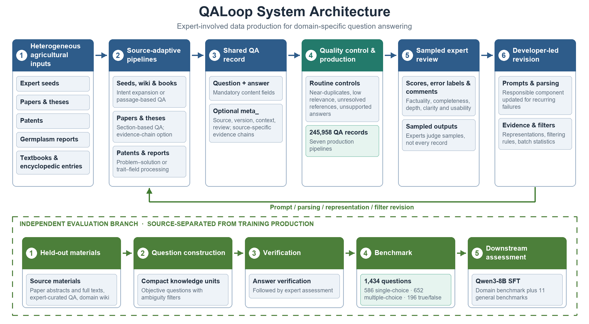

# QALoop

**Expert-Involved Data Production for Domain-Specific Question Answering**

Code release for the DASFAA 2027 Industry Track submission. QALoop is a data production system that combines source-adaptive QA generation, a shared record format, and expert-involved development and quality auditing. Heterogeneous sources are routed to source-adaptive pipelines, experts review sampled outputs, and developers revise prompts, representations, and filters.

In an agricultural plant-breeding deployment, seven production pipelines produced **245,958 QA records**. The latest recorded expert audits found **94.3–100%** of sampled answers accurate in six pipelines. An independent evaluation set contains **1,434** source-separated questions. Experts also compared eleven candidate generators with model identities hidden. Downstream full-parameter SFT of Qwen3-8B raised the domain hierarchical macro-average from **84.58 to 88.17**. The mean score on eleven general benchmarks decreased from **82.34 to 79.96**.

## System Architecture



The diagram above shows the end-to-end QALoop workflow: heterogeneous agricultural sources are routed through source-adaptive QA synthesis pipelines into a candidate QA pool, then validated on the **Expert Validation Platform** (`platform/`). A feedback and iteration engine closes the loop; outputs include curated training QA, an independent benchmark, and downstream model evaluation.

## Project Structure

```
QALoop/
├── platform/      # Annotation and evaluation platform (FastAPI web app)
├── pipelines/     # QA generation pipeline collection
├── data/          # Local data storage (SQLite database, gitignored)
└── LICENSE
```

## Modules

### platform/ — Annotation and Evaluation Platform

A multi-user collaborative annotation platform built on FastAPI. It supports project and dataset management, flexible annotation configurations (rating, classification, text, single/multi-select, binary), statistical analysis, and export. Optionally integrates LLM-based intelligent analysis of annotation notes.

See [platform/README.md](platform/README.md) for details.

### pipelines/ — QA Generation Pipelines

Code for the seven production pipelines in the paper, plus two extensions and a quality check. Each directory contains its own README, examples, and documentation.

See [pipelines/README.md](pipelines/README.md) for which directory corresponds to which pipeline.

## What's Released

This repository focuses on **reusable framework code**, not unrestricted release of all production data:

| Included | Description |
|----------|-------------|
| `platform/` | Expert validation & annotation platform (FastAPI) |
| `pipelines/` | Source-adaptive QA synthesis pipelines with minimal runnable examples. |
| Documentation | READMEs, configuration guides, and deployment instructions |

Production-scale datasets and the full independent benchmark from the paper are **not** included in this release. See the paper for data availability details.

## Citation

If you use QALoop in your research, please cite:

```bibtex
@inproceedings{guo2027qaloop,
  title={QALoop: Expert-Involved Data Production for Domain-Specific Question Answering},
  author={Guo, Menghao and others},
  booktitle={Database Systems for Advanced Applications (DASFAA), Industry Track},
  year={2027},
  note={Submitted}
}
```

> The author list will be completed when the paper is published.

## Quick Start

### Launch the Annotation Platform

```bash
cd platform

# Install dependencies
uv sync

# Configure environment variables
cp .env.example .env
# Edit .env and update SECRET_KEY

# Create superuser
python scripts/create_superuser.py

# Start the server
uvicorn qa_annotate.main:app --reload --host 0.0.0.0 --port 8000
```

See [platform/README.md](platform/README.md) for details.

## Requirements

- Python >= 3.12
- [uv](https://docs.astral.sh/uv/)

## License

MIT
