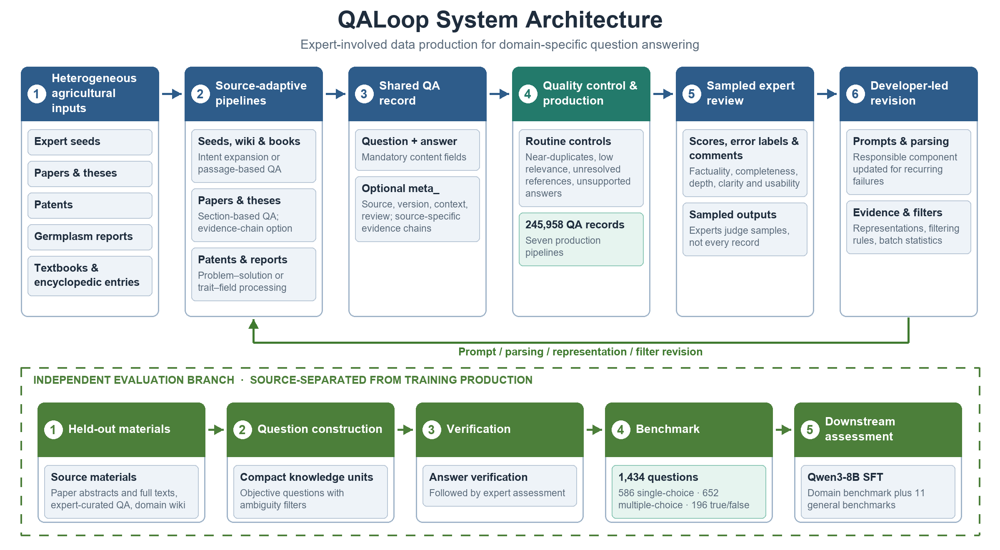

# QALoop

**面向领域问答的专家参与数据生产系统**

DASFAA 2027 Industry Track 投稿的代码发布。QALoop 把源适配问答生成、统一记录格式，以及专家参与的开发与质量审核放在同一套流程里。异构来源进入各自的生成管道，专家抽查样本，开发者据此修改提示词、中间表示和过滤规则。

在农业植物育种部署中，7 条生产管道产出 **245,958 条 QA 记录**。六条管道最近一次有记录的专家审核中，抽查答案的准确比例为 **94.3%–100%**。独立评测集包含 **1,434** 道来源隔离的题目。专家还对 11 个候选生成模型做了身份隐藏的比较。下游对 Qwen3-8B 全参数 SFT 后，领域分层宏平均从 **84.58 升到 88.17**；11 个通用基准的平均分从 **82.34 降到 79.96**。

## 系统架构



上图展示了 QALoop 端到端流程：异构农业来源经源适配问答合成管道进入候选问答池，再在 **专家验证平台**（`platform/`）完成抽查；开发者根据反馈修订提示词、表示和过滤规则。输出包括训练用问答、独立评测集和下游模型评测。

## 项目结构

```
QALoop/
├── platform/      # 标注与评测平台（FastAPI Web 应用）
├── pipelines/     # QA 生成 Pipeline 集合
├── data/          # 本地数据存储（SQLite 数据库，已 gitignore）
└── LICENSE
```

## 模块说明

### platform/ — 标注与评测平台

基于 FastAPI 的多用户协作标注平台，支持项目/数据集管理、灵活的标注配置（评分、分类、文本、单选/多选、二元）、统计分析与导出。可选集成 LLM 对标注备注进行智能分析。

详见 [platform/README.md](platform/README.md)。

### pipelines/ — QA 生成 Pipeline

论文中七条生产管道的代码，以及两条扩展和一项质检。各目录下包含各自的 README、示例与文档。

各文件夹与论文的对应关系见 [pipelines/README.md](pipelines/README.md)。

## 发布内容说明

本仓库聚焦**可复用框架代码**，而非无限制公开全部生产数据：

| 包含 | 说明 |
|------|------|
| `platform/` | 专家验证与协作标注平台（FastAPI） |
| `pipelines/` | 源适配 QA 合成管道及最小可运行示例。 |
| 文档 | README、配置与部署说明 |

论文中的生产级数据集与完整独立 Benchmark **未**包含在本发布中，数据获取方式见论文说明。

## 引用

如在研究中使用 QALoop，请引用：

```bibtex
@inproceedings{guo2027qaloop,
  title={QALoop: Expert-Involved Data Production for Domain-Specific Question Answering},
  author={Guo, Menghao and others},
  booktitle={Database Systems for Advanced Applications (DASFAA), Industry Track},
  year={2027},
  note={Submitted}
}
```

> 作者列表在论文发表后补全。

## 快速开始

### 启动标注平台

```bash
cd platform

# 安装依赖
uv sync

# 配置环境变量
cp .env.example .env
# 编辑 .env，修改 SECRET_KEY

# 创建超级用户
python scripts/create_superuser.py

# 启动
uvicorn qa_annotate.main:app --reload --host 0.0.0.0 --port 8000
```

详见 [platform/README.md](platform/README.md)。

## 环境要求

- Python >= 3.12
- [uv](https://docs.astral.sh/uv/)

## License

MIT
